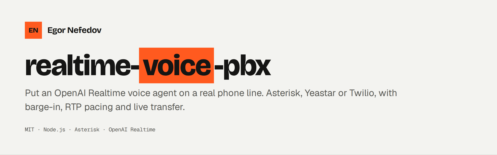
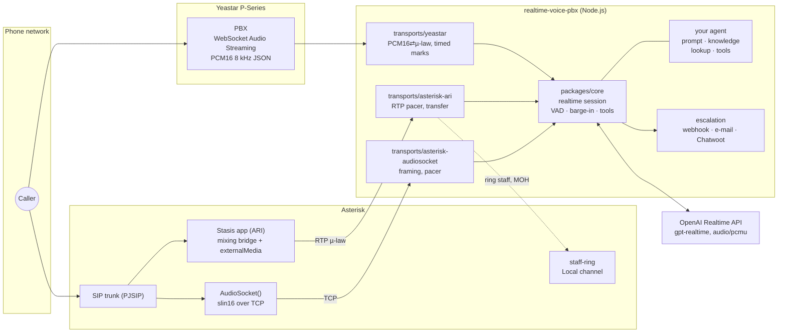
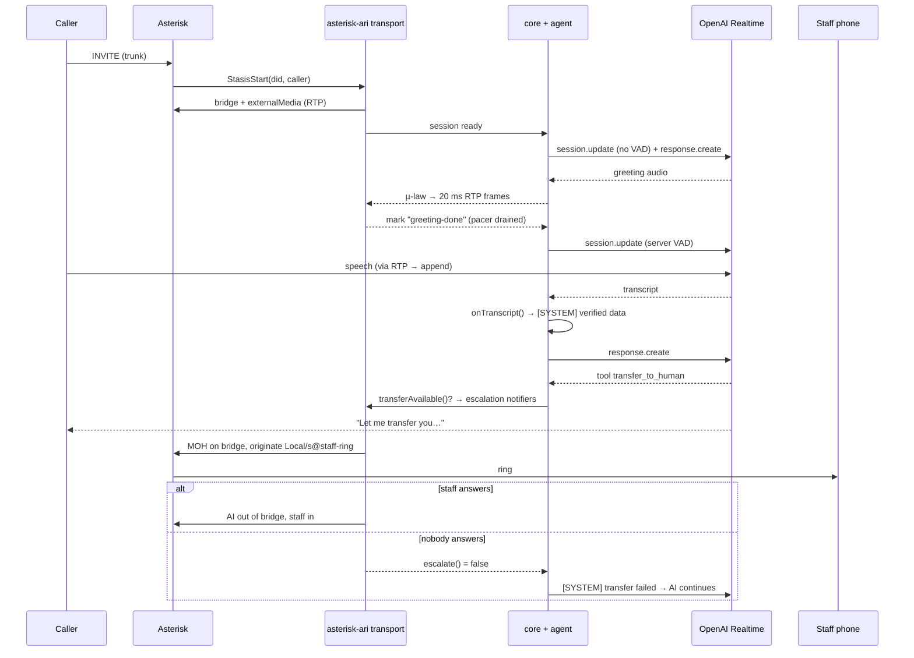
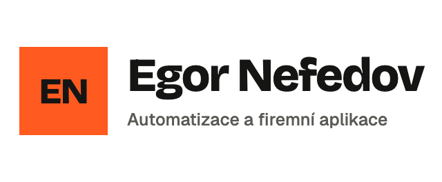

<picture>
  <source media="(prefers-color-scheme: dark)" srcset=".github/assets/banner-dark.png">
  
</picture>

<p>
  <a href="https://github.com/egornefedovcz/realtime-voice-pbx/actions/workflows/ci.yml"></a>
  <a href="LICENSE"></a>
  
  
</p>

**Put an OpenAI Realtime voice agent on a real phone line.** It connects your PBX
(Yeastar P-Series, Asterisk via ARI or AudioSocket, or Twilio for testing) to the
OpenAI Realtime API. The core handles the parts that are hard to get right on
the phone: greeting timing, barge-in, 20 ms RTP pacing, filtering
speech-to-text hallucinations, caller lookup, live transfer to staff,
escalation, and transcribing recorded calls afterwards.

Everything specific to your business is a plug-in: the prompt, the knowledge
base, the caller lookup, the tools and where escalations go.

> This code ran a production customer-support phone line for months before it
> was extracted and generalised here. It was built for Czech and English callers;
> other languages work as well as the Realtime model handles them.

---

## Why

Demos of speech-to-speech models usually run in a browser. A phone line is
harder:

- **8 kHz G.711 audio**, so speech-to-text needs help (a language hint, a hallucination filter).
- **The PBX does not buffer.** Audio has to be paced at 160 bytes every 20 ms, or the caller hears bursts and gaps.
- **Line noise interrupts the greeting** unless voice detection starts only after the greeting has actually played.
- **The model makes things up** when it has no data. Here every caller turn is transcribed first, so your code can look things up and inject *verified* data before the model answers.
- **Callers want a human.** The agent rings staff in the background while the caller hears music on hold. If nobody answers, the AI carries on in the same conversation and the request still reaches your helpdesk.

## Features

| | |
|---|---|
| Transports | Yeastar P-Series WebSocket audio · Asterisk ARI + RTP external media · Asterisk AudioSocket · Twilio Media Streams |
| Conversation | greeting handshake, server VAD after greeting, barge-in (`response.cancel` + transport flush), max call duration |
| Grounding | `onTranscript` hook injects verified data as an internal `[SYSTEM]` note before each answer; function-calling tools |
| Caller lookup | pluggable `lookupCaller(phone)`; result goes into the instructions as background (never "assume this is the person") |
| Escalation | webhook, SMTP e-mail, Chatwoot (de-duplicates repeated calls); summary with verified facts; once per call |
| Live transfer | (ARI) background staff ringing, music on hold, online-check of SIP extensions, rota API or static list, fallback number |
| Audio | µ-law ⇄ PCM16, hrtime-corrected RTP pacer, emulated playback marks for transports without them, synthetic "typing" sound while numbers are looked up |
| After the call | `tools/call-transcripts`: MixMonitor → ffmpeg → `gpt-4o-transcribe` → JSON summary, 90-day retention, weekly digest of recurring questions |

## Architecture



**Asterisk ARI call flow** (live transfer):



## Quick start

Requirements: Node.js 18.17+, an OpenAI API key with Realtime access, and one of
the PBX options below.

```bash
git clone https://github.com/egornefedovcz/realtime-voice-pbx.git
cd realtime-voice-pbx
npm install
cp .env.example .env       # set OPENAI_API_KEY and TRANSPORT
npm test                   # offline tests, no API calls
npm start
```

`GET /health` returns `{"status":"ok", ...}`.

The default agent (`examples/pottery-studio`) is a fictional pottery studio with
a knowledge base, a JSON customer file, a transcript hook and two tools. Copy it
and replace the content.

### Option A: Asterisk + AudioSocket (simplest)

1. Load `res_audiosocket`, `func_curl` and `func_shell` in Asterisk.
2. Put your SIP provider in `.env` (`SIP_SERVER`, `SIP_USER`, `SIP_PASSWORD`, `SIP_PROVIDER_CIDR`) and run
   `sudo transports/asterisk-audiosocket/asterisk/render-pjsip.sh .env`, then add `#include pjsip.trunk.conf` to `pjsip.conf`.
3. Copy `transports/asterisk-audiosocket/asterisk/extensions.conf` into your dialplan (context `from-trunk`).
4. `TRANSPORT=asterisk-audiosocket npm start` and call your number.

No live transfer on this transport. Escalation goes through the notifiers.

### Option B: Asterisk + ARI (live transfer to staff)

1. Use `transports/asterisk-ari/asterisk/http.conf` (ARI on localhost only) and render
   `ari.conf`, the trunk and optional staff extensions with `render-config.sh .env`.
2. Copy `extensions.conf` (contexts `from-trunk`, `staff-ring`, `outbound`, `test-inbound`).
   The Stasis app name in the dialplan must equal `ARI_APP`.
3. Set `ARI_PASSWORD`, `RTP_PORT_MIN/MAX`, and either `STAFF_DIAL_TARGETS=PJSIP/staff201&PJSIP/staff202`
   or `SHIFTS_URL` (your rota API), plus an optional `FALLBACK_NUMBER`.
4. `TRANSPORT=asterisk-ari npm start`. Test without a trunk:
   `asterisk -rx "channel originate Local/100@test-inbound extension 101@test-caller"`.

### Option C: Yeastar P-Series

> **Experimental.** This transport was rebuilt from an earlier production version and has not yet been re-tested against a real Yeastar PBX in its current form. The Asterisk ARI transport is the one in daily use. Reports and fixes are welcome.

1. Expose the service over TLS (reverse proxy) and configure the PBX's
   *WebSocket Audio Streaming* to `wss://<host>/yeastar-stream`.
2. Set the same secret on the PBX and as `YEASTAR_SECRET`. It is accepted in the
   `secret`, `x-auth-token`, `authorization` or `x-api-key` header.
3. `TRANSPORT=yeastar npm start`.

### Option D: Twilio (testing without a PBX)

Point the number's voice webhook to `POST https://<host>/incoming-call` and run
`TRANSPORT=twilio npm start`. Several transports can run at once:
`TRANSPORT=yeastar,twilio`.

## Configuration

All settings come from environment variables (or `.env`, or the file in `ENV_FILE`).
`.env.example` lists every variable.

| Variable | Default | Description |
|---|---|---|
| `OPENAI_API_KEY` |, | **required** |
| `TRANSPORT` | `yeastar` | `yeastar`, `asterisk-ari`, `asterisk-audiosocket`, `twilio` (comma-separated) |
| `AGENT` | `examples/pottery-studio` | module that exports your agent |
| `PORT` / `HOST` | `8080` / `0.0.0.0` | HTTP server (health, Yeastar, Twilio) |
| `REALTIME_MODEL` | `gpt-realtime` | Realtime model |
| `VOICE` / `VOICE_SPEED` | `ash` / `1.1` | output voice |
| `TRANSCRIBE_MODEL` | `gpt-4o-transcribe` | caller transcription model |
| `TRANSCRIBE_LANGUAGE` | (auto) | ISO-639-1 hint, e.g. `cs` (strongly recommended for non-English) |
| `VAD_THRESHOLD` / `VAD_PREFIX_MS` / `VAD_SILENCE_MS` | `0.5` / `300` / `900` | server VAD tuning |
| `MAX_CALL_SECONDS` | `900` | hang up after this (0 = off) |
| `SUMMARY_MODEL` | `gpt-4o` | escalation summary model |
| `YEASTAR_SECRET` / `YEASTAR_PATH` |, / `/yeastar-stream` | Yeastar auth and WebSocket path |
| `ARI_URL` / `ARI_USER` / `ARI_PASSWORD` / `ARI_APP` | `http://127.0.0.1:8088` / `voicebot` /, / `voicebot` | Asterisk ARI |
| `RTP_HOST` / `RTP_PORT_MIN` / `RTP_PORT_MAX` | `127.0.0.1` / `40000` / `40100` | external media RTP (2 ports per call) |
| `STAFF_DIAL_TARGETS` |, | static transfer targets, `&`-separated dial strings |
| `SHIFTS_URL` / `SHIFTS_TOKEN` |, | rota API returning `{ "operators": [{ "name", "sipExtension" \| "externalPhone" }] }` |
| `FALLBACK_NUMBER` |, | dialled via `[outbound]` when no staff target exists or nobody answers |
| `RING_TIMEOUT` / `MOH_CLASS` / `STAFF_CONTEXT` | `30` / `default` / `staff-ring` | transfer behaviour |
| `DEFAULT_COUNTRY_CODE` / `NATIONAL_NUMBER_LENGTH` |, / `9` | normalise national numbers from the rota |
| `AUDIOSOCKET_HOST` / `AUDIOSOCKET_PORT` / `AUDIOSOCKET_HTTP_PORT` | `127.0.0.1` / `9092` / `9093` | AudioSocket server and caller-id side channel |
| `ESCALATION_WEBHOOK_URL` / `ESCALATION_WEBHOOK_SECRET` |, | POST JSON handoff (`X-Webhook-Secret` header) |
| `SMTP_HOST` `SMTP_PORT` `SMTP_USER` `SMTP_PASS` `ESCALATION_EMAIL_FROM` `ESCALATION_EMAIL_TO` |, | e-mail handoff (needs `nodemailer`) |
| `CHATWOOT_URL` `CHATWOOT_API_TOKEN` `CHATWOOT_ACCOUNT_ID` `CHATWOOT_INBOX_ID` `CHATWOOT_DEDUPE_INBOX_IDS` |, | Chatwoot handoff |

`tools/call-transcripts` has its own variables, listed in [its README](tools/call-transcripts/README.md).

## Write your own agent

An agent is a plain object made with `defineAgent()`. Only `instructions` is required.

```js
// my-agent/index.js
const { defineAgent, fileKnowledge, escalation } = require('realtime-voice-pbx'); // or a relative path to packages/core

const knowledge = fileKnowledge(__dirname + '/facts.md'); // re-read on every call

module.exports = defineAgent({
  name: 'Acme Support',
  greeting: 'Hello, this is Acme’s virtual assistant. This call may be recorded. How can I help?',
  instructions: (call) => `You are Acme's phone assistant. Short sentences...\n\n${knowledge()}`,

  lookupCaller: async (phone) => db.customers.findByPhone(phone),        // -> { name, email, ... } | null
  async onTranscript(text, call) {                                       // -> string[] of verified facts
    const order = await db.orders.findInText(text);
    if (!order) return [];
    call.facts.orderNumber = order.number;                               // used by the escalation summary
    return [`Order found: ${JSON.stringify(order)}`];
  },
  tools: [{
    name: 'opening_hours',
    description: 'Opening hours for a branch',
    parameters: { type: 'object', properties: { branch: { type: 'string' } }, required: ['branch'] },
    handler: async ({ branch }) => ({ hours: await db.hours(branch) }),
  }],
  escalation: escalation.notifiersFromEnv({ agentName: 'Acme voice assistant' }),
});
```

Run it with `AGENT=./my-agent npm start`.

### Prompt and knowledge

- `instructions(call)` may be async, for example to fetch your knowledge from an API (see `examples/http-backend`).
  It is rebuilt every time the session is reconfigured (greeting, VAD on, caller identified).
- The core appends the caller's number, the caller background, the transfer rules
  and the exact greeting. Your prompt should not repeat them.
- **Keep instructions under about 16k tokens.** Above that the Realtime API rejects them
  and the model runs with no instructions at all. `fileKnowledge()` truncates at
  45,000 characters and logs a warning.
- Good phone rules are in `examples/pottery-studio/prompt.js`: short turns, no
  markdown, no made-up numbers, farewell only after a clear goodbye.

### Caller lookup

`lookupCaller(phone, call)` runs in the background when the call starts, so it
never delays the greeting. Set `waitForLookupMs` if the greeting depends on it.
The result is added as *background* information: anyone can call from a
number, so the model is told not to assume who is speaking. Override
`describeCaller(record)` to change that text. A Postgres version is a few lines:

```js
lookupCaller: async (phone) => {
  const key = phone.replace(/\D/g, '').slice(-9);
  const { rows } = await pool.query(
    "SELECT full_name AS name, email FROM customers WHERE RIGHT(regexp_replace(phone, '\\D', '', 'g'), 9) = $1 LIMIT 1", [key]);
  return rows[0] || null;
},
```

### Grounding: `onTranscript` vs tools

- **`onTranscript(text, call)`** runs after every caller sentence and *before*
  the answer. Use it for cheap, deterministic lookups such as order numbers in
  the sentence or keywords like "opening hours". The model cannot skip it.
  Return `[]` when there is nothing to add. Keep it fast, because the caller is waiting.
- **Tools** are standard Realtime function calls. The model decides when to call them.
  Outputs are sent back at `response.done`. `handler(args, call, { handoff })` can
  trigger escalation itself (see `leave_message` in the example).

### Escalation

A notifier is `{ name, notify(handoff) }`. The handoff object looks like this:

```js
{ callId, callerPhone, didNumber, caller, facts, conversation: [{ role, text }], summary, reason, at }
```

Escalation fires **once per call**, when the transfer tool runs, when a tool
calls `handoff()`, or when the agent says a handoff sentence (`handoffPhrases`,
English and Czech by default). Built-in notifiers: `webhookNotifier`,
`emailNotifier`, `chatwootNotifier` and `consoleNotifier`. `notifiersFromEnv()` picks the
ones that are configured. Writing your own takes about ten lines:

```js
const slack = { name: 'slack', notify: async (h) => {
  await fetch(process.env.SLACK_WEBHOOK, { method: 'POST', headers: { 'Content-Type': 'application/json' },
    body: JSON.stringify({ text: `${h.callerPhone}: ${h.summary || h.conversation.at(-1)?.text}` }) });
} };
```

### Other hooks

`returnGreeting`, `messages.{transferPrompt,transferFailed,returnedNoAnswer}`,
`transferPhrases`, `hallucinations` (extra strings to ignore), `typingSound`
(default on), `summarize`, `summaryLanguage`, `ownContacts` (your own
phone/e-mail, so the summary never lists them as the caller's), `onCallEnd(call)`
(for example, send an SMS when `call.staffMissed`), and `session` (per-agent
overrides: `voice`, `speed`, `transcribeLanguage`, `vadSilenceMs`, `maxCallSeconds`, …).

### Languages

The model answers in the caller's language when the prompt tells it to. For
**Czech** (where this project was built), set `TRANSCRIBE_LANGUAGE=cs`. Without
the hint, 8 kHz Czech was sometimes transcribed in Cyrillic. With `cs` set,
English speech is still transcribed in English. If your prompt is written in
one language and callers use another, add an explicit "reply in the caller's
language, including every closing question" rule, and translate example phrases.

## Latency and cost

**Latency.** The time from the caller finishing a sentence to the first audio
back is roughly the sum of these parts:

1. VAD silence (`VAD_SILENCE_MS`, default 900 ms). This is the biggest knob. Lower values feel snappier but cut off slow speakers.
2. Transcription of the turn. Responses are created manually after the transcript arrives, so `onTranscript` can add data. This costs some latency in exchange for grounded answers.
3. Your `onTranscript` lookups. Keep them in the tens of milliseconds and index your database by phone or order number.
4. Model time to the first audio, plus network distance to OpenAI. Host the service close to the API region and to your PBX.

If you don't need pre-answer grounding, a variant with `create_response: true`
is faster. Fork `realtime.js`; the change is small.

**Cost.** You pay for Realtime audio input and output, the instruction and
context tokens of each response (a long knowledge base is re-read on every
turn), transcription of the caller's audio, and a short summary per escalation.
The optional call-transcripts tool adds per-minute transcription and a summary
per call. Check current OpenAI pricing, and use `MAX_CALL_SECONDS` as a safety cap.

## Limitations

- **Live transfer only on Asterisk ARI.** Yeastar, AudioSocket and Twilio escalate asynchronously.
- **Yeastar:** sending audio back is not documented by Yeastar; the transport mirrors the inbound envelope. Playback marks are estimated from bytes sent, and barge-in cannot recall audio the PBX has already buffered.
- **ARI RTP** has no jitter buffer. Late or duplicate packets are dropped, which is fine for speech recognition. Run Asterisk and this service on the same host or LAN.
- **AudioSocket** caller id travels over a small localhost HTTP side channel, because AudioSocket only sends a UUID.
- One OpenAI Realtime session per call. Concurrency is limited by your OpenAI rate limits and, for ARI, by the RTP port range.
- No DTMF handling, no outbound calling campaigns, no Twilio request signature validation (put the webhook behind a secret path or a proxy check).
- Handoff phrase detection is regex-based (English and Czech defaults). Adjust `handoffPhrases` for other languages.
- Recording calls and processing personal data is regulated in many countries. Tell callers and set a retention period.

## Project layout

```
packages/core/            realtime session, agent definition, audio, RTP, knowledge, summary, escalation
transports/yeastar/       Yeastar P-Series WebSocket audio streaming
transports/asterisk-ari/  ARI + RTP external media, staff routing, sample Asterisk configs
transports/asterisk-audiosocket/  AudioSocket server, sample dialplan + trunk template
transports/twilio/        Twilio Media Streams
tools/call-transcripts/   recording → transcript → summary, weekly digest
examples/                 pottery-studio (full), minimal, http-backend
bin/start.js              entry point (TRANSPORT, AGENT)
test/                     node:test suites (no network, no API key)
```

## Contributing

Issues and pull requests are welcome. See [CONTRIBUTING.md](CONTRIBUTING.md) and
[SECURITY.md](SECURITY.md).

## License

[MIT](LICENSE). Copyright (c) 2026 Egor Nefedov.

---

<a href="https://www.nefedov.cz/"><picture><source media="(prefers-color-scheme: dark)" srcset=".github/assets/logo-dark.png"></picture></a>

Built and maintained by [Egor Nefedov](https://www.nefedov.cz/), automations and custom business apps from Prague. Issues and pull requests are welcome.
